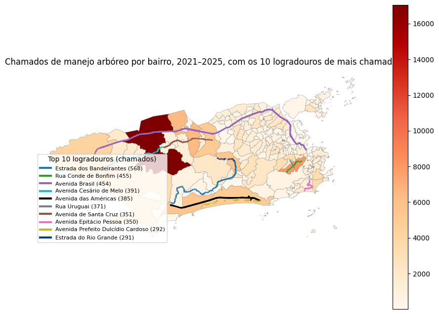

# Chamados de poda de árvore no Rio de Janeiro: uma análise com dados abertos

Análise exploratória dos chamados de **manejo arbóreo (poda de árvore)** da Central 1746 e das
ocorrências do **Centro de Operações Rio (COR)**, a partir das tabelas públicas do
[Data.Rio](https://www.data.rio/) no BigQuery.

**Pergunta de fundo:** a prefeitura consegue saber, com os dados que já tem, *quando um chamado de poda
pode virar um problema maior*, como uma queda de árvore, uma queda sobre a fiação ou uma falta de luz?

> 📌 **Resumo rápido:** a suposição inicial e as conclusões em uma página estão em **[RESUMO.md](RESUMO.md)**.



## Notebooks

Cada notebook abre com uma apresentação (contexto, pergunta, dados, roteiro e principais resultados) e
guarda as saídas da execução original, então dá para ler tudo direto no GitHub.

| # | Notebook | Pergunta | Abrir |
|---|---|---|---|
| 01 | [Catálogo de subtipos](01_catalogo_de_subtipos.ipynb) | O que conta como "poda" no 1746? | [](https://colab.research.google.com/github/renanbrettas/Projeto-ci-ncia-de-dados---Podas-de-rvore/blob/main/01_catalogo_de_subtipos.ipynb) |
| 02 | [Light e COR](02_light_e_cor.ipynb) | Dá para ligar a poda à rede elétrica com dados abertos? | [](https://colab.research.google.com/github/renanbrettas/Projeto-ci-ncia-de-dados---Podas-de-rvore/blob/main/02_light_e_cor.ipynb) |
| 03 | [Qualidade e extração](03_qualidade_e_extracao.ipynb) | Quão bem localizados estão os chamados? | [](https://colab.research.google.com/github/renanbrettas/Projeto-ci-ncia-de-dados---Podas-de-rvore/blob/main/03_qualidade_e_extracao.ipynb) |
| 04 | [Análise espacial](04_analise_espacial.ipynb) | Onde se concentram os chamados? | [](https://colab.research.google.com/github/renanbrettas/Projeto-ci-ncia-de-dados---Podas-de-rvore/blob/main/04_analise_espacial.ipynb) |
| 05 | [Poda → queda](05_poda_queda.ipynb) | A poda antecipa a queda da árvore? | [](https://colab.research.google.com/github/renanbrettas/Projeto-ci-ncia-de-dados---Podas-de-rvore/blob/main/05_poda_queda.ipynb) |

---

## Principais resultados

| # | Achado | Onde |
|---|---|---|
| 1 | O 1746 registrou **20,3 milhões** de chamados em 5.545 combinações tipo/subtipo. A poda aparece em vários subtipos quase idênticos, por causa de mudanças na taxonomia. O recorte adotado tem 3 subtipos e **133.715 chamados em 2021–2025**. | [01](01_catalogo_de_subtipos.ipynb) |
| 2 | A **Light não aparece no 1746**: a poda é atendida pela COMLURB, e nenhuma justificativa menciona fiação ou rede elétrica. | [02](02_light_e_cor.ipynb) |
| 3 | No **COR**, a Light tem **5.407 acionamentos em 2.940 eventos**, sobretudo em queda de árvore (1.103) e queda de poste (345). Mas a tabela **termina em abril de 2024**, reaproveita IDs e tem lacunas de registro. | [02](02_light_e_cor.ipynb) |
| 4 | A localização por logradouro é boa (~98–99%), mas a **coordenada válida cai de 94,7% (2021) para 59,2% (2025)**. | [03](03_qualidade_e_extracao.ipynb) |
| 5 | Foram **212.501** chamados de manejo arbóreo em 2021–2025, distribuídos por 14.089 logradouros. Os campeões são vias longas (Estrada dos Bandeirantes, R. Conde de Bonfim, Av. Brasil), então comparar logradouros exige normalizar pela extensão. | [04](04_analise_espacial.ipynb) |
| 6 | **Poda → queda:** a partir de 30 dias, a chance de queda de árvore no mesmo logradouro depois de uma poda é *menor* do que o acaso prevê (razão obs/esp de 0,74 a 0,85). O pequeno excesso em 7 dias aparece também *antes* da poda, o que indica registro conjunto do mesmo episódio, e não antecipação. | [05](05_poda_queda.ipynb) |

**Conclusão:** com o recorte e a unidade espacial usados até aqui, **o volume de chamados de poda, sozinho,
não antecipa quedas de árvore**. Para a questão da rede elétrica, os dados abertos do Data.Rio são
insuficientes. Os próximos passos estão listados [abaixo](#próximos-passos).

Detalhes, decisões e problemas de qualidade dos dados: [`docs/achados_e_qualidade_dos_dados.md`](docs/achados_e_qualidade_dos_dados.md).

---

## Estrutura do repositório

```
├── 01_catalogo_de_subtipos.ipynb    # taxonomia do 1746 e definição do recorte de poda
├── 02_light_e_cor.ipynb             # Light no 1746 e no COR; integridade das tabelas do COR
├── 03_qualidade_e_extracao.ipynb    # qualidade da localização; extração base 2021–2025
├── 04_analise_espacial.ipynb        # bairros, logradouros, mapas
├── 05_poda_queda.ipynb              # poda -> queda: incidência vs. acaso
├── RESUMO.md                        # suposição inicial e conclusões, em uma página
├── src/podas/
│   ├── bq.py        # conexão com o BigQuery e consultas com estimativa de custo
│   ├── config.py    # tabelas, recortes, período e caminhos
│   └── cep.py       # análise poda -> queda por CEP (próxima etapa)
├── sql/             # consultas principais em SQL puro
├── figures/         # mapas exportados
├── docs/            # achados detalhados e notas de qualidade dos dados
├── data/            # extrações locais (não versionadas)
└── outputs/         # planilhas geradas (não versionadas)
```

## Fontes de dados

Todas as tabelas são públicas, no projeto `datario` do BigQuery:

| Tabela | Conteúdo |
|---|---|
| `adm_central_atendimento_1746.chamado` | Chamados da Central 1746 (tipo, subtipo, datas, bairro, logradouro, coordenadas, unidade responsável) |
| `adm_cor_comando.ocorrencias` | Ocorrências do Centro de Operações Rio (até 02/04/2024) |
| `adm_cor_comando.ocorrencias_orgaos_responsaveis` | Órgãos acionados em cada ocorrência (inclui a Light) |
| `adm_cor_comando.procedimento_operacional_padrao` | Nome dos procedimentos (`id_pop`), ex.: "Queda de árvore sobre fiação" |
| `dados_mestres.bairro` / `dados_mestres.logradouro` | Polígonos de bairro e trechos de logradouro |

## Como reproduzir

**1. Ambiente**

```bash
git clone https://github.com/renanbrettas/Projeto-ci-ncia-de-dados---Podas-de-rvore.git
cd Projeto-ci-ncia-de-dados---Podas-de-rvore
python -m venv .venv && source .venv/bin/activate
pip install -r requirements.txt
```

**2. Acesso ao BigQuery.** É preciso um projeto no Google Cloud para pagar a leitura; as consultas
costumam processar de 0,01 a 2,5 GB, dentro da cota gratuita mensal.

```bash
gcloud auth application-default login
export GCP_PROJECT_ID=seu-projeto-gcp
```

No **Google Colab**, use os botões "Open in Colab" da tabela acima e descomente, na célula de
configuração, a linha `os.environ["GCP_PROJECT_ID"] = ...` com o seu projeto. O código do repositório
é baixado e a autenticação é pedida automaticamente.

**3. Ordem de execução.** Rode os notebooks de 01 a 05. O notebook 03 gera `data/poda_2021_2025.parquet`,
que os notebooks 04 e 05 usam. Toda consulta mostra o custo estimado antes de rodar e tem um teto de
bytes faturados (`src/podas/bq.py`).

## Próximos passos

1. **Trocar a unidade espacial** de logradouro para trecho ou CEP, para tirar o viés das vias longas
   (`src/podas/cep.py` já tem a atribuição de CEP por vizinho mais próximo e o cálculo poda → queda).
2. **Incluir a chuva** (índice pluviométrico do BigQuery) como covariável: quedas e podas se concentram
   em temporais, o que explica o excesso de curto prazo nas duas direções.
3. **Dados da Light ou do COR atualizados** para ocorrências na rede elétrica depois de abril de 2024.
4. Usar o tempo até o atendimento da poda (o atendimento pode *prevenir* a queda) e passar de
   incidência para um modelo de risco por local.

## Licença

Código sob a licença MIT (ver [LICENSE](LICENSE)). Os dados pertencem à Prefeitura do Rio de Janeiro e
seguem os termos do Data.Rio.
